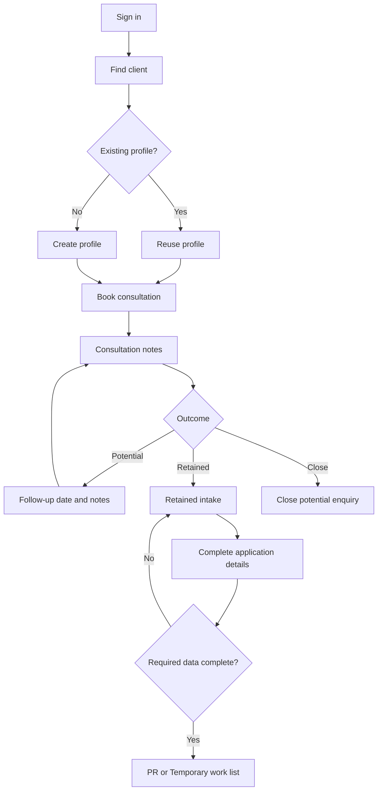
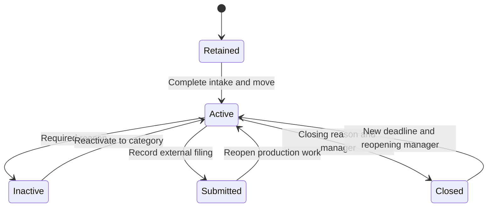
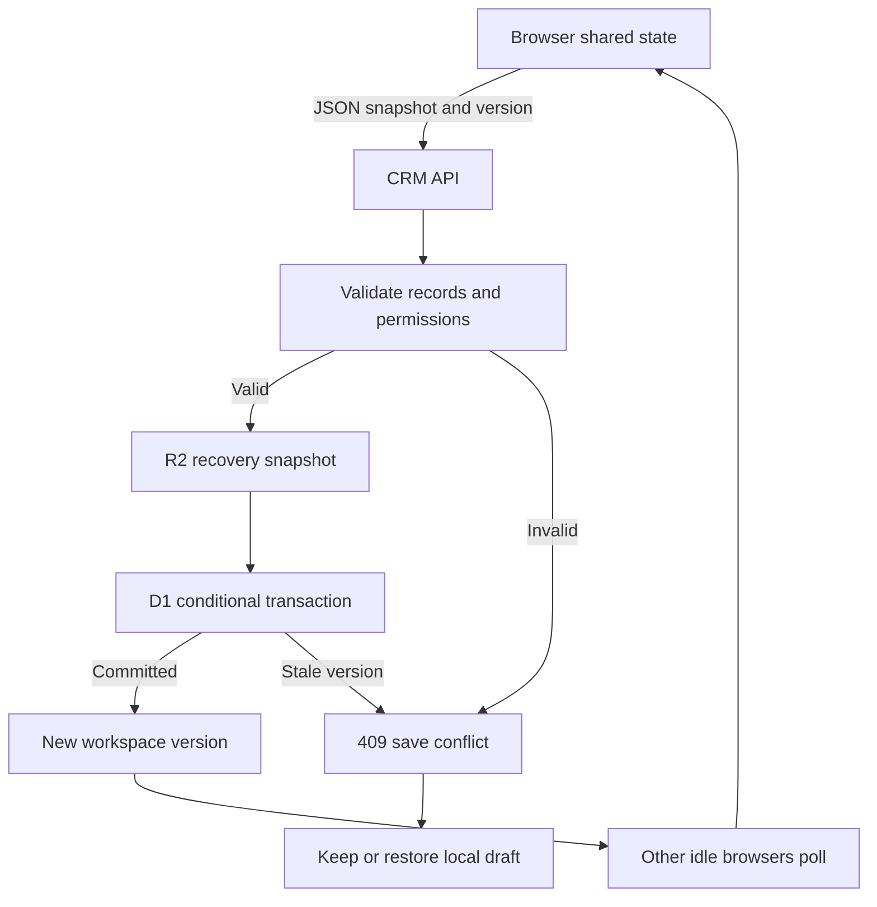
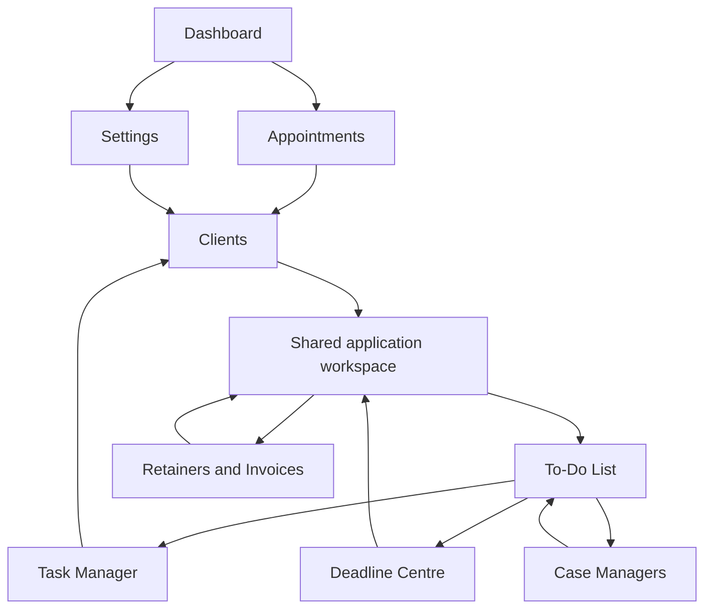
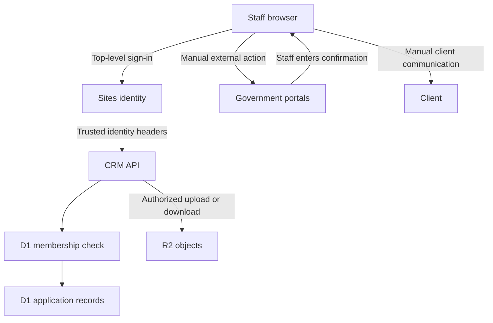

# End-to-end product workflows

Source revision: `430beb1782e639d935eaa391df94b751a1047fb7`. Generated UTC: 2026-10-14T22:36:46.223528+00:00. Source snapshot in `SOURCE_CODE/`. All line references are to that snapshot.


These five requested candidate journeys have been verified against code. Missing professional review, external delivery, evidence versioning and platform sign-in are explicitly not treated as completed steps.

## Workflow A — New appointment to client conversion

**Actor:** Reception or owner

**Preconditions:** Existing member; choose new consultation or Staff; staff booking requires existing client

**Steps:** appointmentDialog → quickBookingMatches → saveAppointment → syncBookingConsultation → outcome/profile disposition

**Data changes:** New profile or existing client updated; appointment appended/edited; consultationRecords synchronized; Retained outcome can open intake matter

**APIs:** PUT state

**Entities:** clients, appointments, matters on conversion

**Rules/branches:** Overlap/name/phone/email/service/date/time checked in browser. Backend checks client existence/unique phone; overlap not enforced. Staff selector loses selected application (DEF-06).

**Failure/recovery:** Save failure sets saveProblem; download unsaved copy and reload latest before retry; no transactional per-form server controller.

**Final state:** Booked or outcome recorded; potential/retained follow-up remains staff work

## Workflow B — Client to immigration application

**Actor:** Owner/case manager; reception limited intake

**Preconditions:** Client exists; complete profile/overview/deadline for moving retained intake

**Steps:** clientActivity → applicationEditor → saveApplication → explicit move → document tracking/case work → submissionDialog → recordSubmission → closure/reopen

**Data changes:** One client can own multiple matters; retainedIntake transitions false; stage changes; notes/docs are separate records

**APIs:** PUT state; documents POST/GET

**Entities:** clients, matters, crm_documents, R2 objects

**Rules/branches:** Current submission does not enforce professional approval, uploaded confirmation or checklist (SEC-02); manual record after staff submission. No government API.

**Failure/recovery:** Draft autosave may fail or conflict; no field merge. Close/reopen locks apply server-side. Reactivate inactive before stage changes.

**Final state:** Submitted record, then manually closed application; reopening creates deadline/manager history

## Workflow C — LMIA management

**Actor:** Owner/case manager

**Preconditions:** Company client or create company; dates/status inputs

**Steps:** newLmiaFile → saveLmiaProfile → LMIA overview and profile → assignment/deadlines → submission/closure

**Data changes:** Company client plus matter.type LMIA; lmia tracking metadata; linked deadlines/tasks

**APIs:** PUT state; optional documents

**Entities:** clients, matters, officeTasks, crm_documents

**Rules/branches:** Frontend date/status validation; no ESDC automation. Inactive workflow excludes LMIA. Server validation broadly accepts JSON.

**Failure/recovery:** Save routine rolls local snapshot back on failure; actual UI error recovery not browser-tested.

**Final state:** Manually tracked Submitted/Closed/other LMIA status

## Workflow D — Staff operations

**Actor:** Owner provisions; case_manager/reception/viewer work within role

**Preconditions:** Both Sites audience access and active crm_members account; staff display name alone insufficient

**Steps:** Settings Access → member upsert → sign-in → assignment → office tasks → completion → expiry

**Data changes:** Membership separate from config.staff and matter.owner; completion stores selected manager plus server audit actor

**APIs:** members GET/POST; state GET/PUT; audit GET

**Entities:** crm_members; config/matters/officeTasks; crm_audit

**Rules/branches:** Viewer cannot write; reception exceptions; nonowner cannot delete. No distinct RCIC role. 7-day task expiry is irreversible from live collection but backups may retain copies.

**Failure/recovery:** Disable membership to revoke app access; separately revoke hosting grant. Concurrent edits conflict workspace-wide.

**Final state:** Assigned work completed/expired; review approval remains policy gap

## Workflow E — Documents

**Actor:** Owner/case_manager upload; all members read files

**Preconditions:** Saved client; optional matter belongs to client; correct size/type

**Steps:** documentManager → uploadLiveDocument → POST documents → loadLiveDocuments → download; independent document review status

**Data changes:** R2 bytes first then metadata/audit transaction; SHA256 stored; no dedup restriction; status review rows live in matters

**APIs:** POST documents; GET documents?clientId; GET documents/:id; PUT state for review rows

**Entities:** crm_documents + crm_audit + R2; matter.documentReviews separately

**Rules/branches:** PDF/JPEG/PNG with magic-header validation; no malware scan; no hard binding between verified review row and uploaded object; no replace/delete document API.

**Failure/recovery:** Upload removes R2 object if metadata transaction fails. Download404 if metadata or bytes missing. Parent deletion can leave orphan object (SEC-08).

**Final state:** Uploaded/downloadable object and separately tracked review; replacement is another upload, retention not defined

# End-to-end workflows

All internal views share `/crm.html` (the published `/crm` URL also opens the CRM). Navigation uses JavaScript `view`, tab and filter variables, not separate React routes. Reload returns to the Dashboard default.

## W01 — Reception to retained application



Phone/email/name matching reduces duplicates; shared phone cases require attention because server uniqueness rejects duplicate normalized phone values. Retained move requires client name, valid phone/email, application overview and valid submission deadline. The assigned manager dropdown can retain Unassigned; a named owner is not a universal server prerequisite. Retaining does not collect money.

## W02 — Staff appointments

Existing client required → choose For Staff → select staff member and optionally application → schedule with overlap check. Staff bookings do not create a consultation record. Some staff application-selector behavior is uncertain: current saveAppointment preserves old relatedApplicationId but does not visibly read `qbapplication`; validate before relying on linkage.

## W03 — Application preparation

Open file → edit Application Details / Client Information → autosave → maintain reminders and timestamped case notes → for PR, review documents → manually progress file stage → record submission after external filing. Fields shared with client profile propagate to all application names and appointment contacts. Creating an application and later moving it are separate operations. Original checklist→forms→RCIC approval chain remains legacy and is not an enforced gate for the current stage dropdown.

## W04 — Inactive and closed states



Inactive is an independent boolean, not a new numeric stage. It keeps the previous stage, manager, notes/documents and deadlines. Government alerts and existing reminders stay active. It excludes files from PR/Temporary work lists. LMIA uses its own On Hold/Not Proceeding process. Closed sets stage 6, locks the record, and pauses linked personal/document reminders; reactivation of Inactive and reopening Closed are different actions. Submitted records retain filing data when reopened.

## W05 — LMIA

Find/create employer → create LMIA application under that profile → record position/openings/wage/recruitment dates/Job Bank/TFW status/submission deadline → select status → optionally On Hold with review date, or Not Proceeding with reason → resume only after reviewing advertisement/submission dates → record external submission. Multiple LMIAs may reuse the same company. Advertisement expiry is a preparation reminder, not an automatically calculated statutory deadline or proof recruitment is complete.

## W06 — Tasks

Create Client Call or Staff Task → choose assigned manager → received/due dates and instructions → active queue → Complete requires selected Completed By and action taken → Completed Tasks for exactly seven elapsed days → system deletion. Calls waiting at least three days appear in Reminders. Reopening an unexpired completed task removes completion metadata; clearing a UI tab is not a delete operation. Legacy completed tasks without reliable expiry get a seven-day grace period at migration/cleanup.

## W07 — PFL / request

Create manual request (client/application text, file number, category, received date, deadline, owner, action and notes) → creates/updates a linked Urgent office task and open request countdown → staff responds externally → select completed manager, comments and method → mark Resolved → associated office task completed if linked → read-only Completed Requests for 30 days in that view. Linked matter hard deadline is recomputed from remaining unresolved hard deadlines. Standalone requests use `fileUpdates.recordType='pflRequest'` and need not link to a client.

## W08 — Client updates

Create update → Approved/Refused/Documents Requested/Other → Checked By and comments → Not Sent/Pending Further → staff communicates externally → record Sent, method and sender → read-only Update Sent view for 30 days. This is not an email/SMS transport; there is no delivery receipt.

## W09 — Retainers and invoices

Move retained intake to active (or create LMIA) → administrative file appears → staff records retainer and invoice status/amounts/terms → Signed + invoice Sent/Paid puts it in Signed Retainers → selected fields lock. This is metadata tracking, not accounting or document generation. Closed retainer status removes it from that administration queue, not necessarily the application lifecycle.

## W10 — Import/recovery

Owner selects prepared JSON → planner reports new, linked, duplicate and review rows → save pending work → preserve original workbook if present → commit batches → unresolved identity rows remain in history → manually link/confirm. Stable import row IDs prevent repeated import. Recovery lists audited snapshots; restore submits old JSON through current validations/version checks, so historical snapshots can be rejected by newer locks. Files in R2 are not restored/deleted with a record snapshot.

## Data movement and save failures



Cross-module movement usually changes the same matter rather than copying it. Active tab lists are derived filters. Some handlers roll back objects on failure; older actions rely on global save status. Autosave is 600ms in application editor and 450ms for general workspace events; polling is every 15 seconds when idle, without open modal/dirty edits/save errors.

## Automated versus manual

Code-driven: save debounce; conditional version rejection; original-workbook hash check; submitted/closed/sent/potential queue expiry; deadline grouping and badge refresh; task purge on state GET and optional scheduled endpoint; assignment/name propagation; audit/snapshot writes. Manual: all legal/communication/submission actions and dates. No discovered queue workers, email dispatch, webhook processor, or AI orchestration. Scheduled task metadata reports disabled cleanup; it must not be described as currently running hourly.

## Module navigation and shared workspaces

Arrows below are common user navigation paths, not required sequential steps. All nine primary modules are available from the persistent sidebar; profile/application are shared secondary surfaces.



## External integration flow



There is no CRM→government or CRM→client transport arrow because no such integration was discovered.


## Save sequence

```mermaid
sequenceDiagram
  participant UI as Browser draft
  participant API as CRM handler
  participant D as D1
  participant R as R2
  UI->>API: PUT state with workspace version
  API->>D: Read current version and rows
  alt stale version
    API-->>UI: 409; reload required
  else valid version and rules
    API->>R: Write candidate recovery snapshot
    API->>D: Gated transactional version, rows, audit
    alt won version race
      API-->>UI: Version and task timestamps
    else lost version race
      API->>R: Delete candidate snapshot
      API-->>UI: 409
    end
  end
```

## Executed verification

Backend tests exercise state persistence, upload/download, original-source integrity, permissions, simultaneous conflicting saves, and simple recovery. They do not execute a browser journey. Restore of a point before a signed-retainer lock returns400 (SEC-11); do not promise arbitrary rollback.
