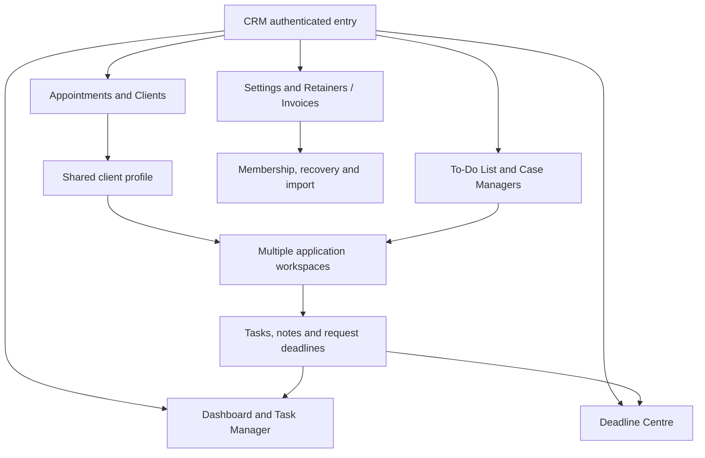

# Product navigation and dependencies

Source revision: `430beb1782e639d935eaa391df94b751a1047fb7`. Generated UTC: 2026-10-14T22:36:46.223528+00:00. Source snapshot in `SOURCE_CODE/`. All line references are to that snapshot.

| Screen ID | Module | Screen/tab/modal | Source entry |
| --- | --- | --- | --- |
| SCR-001 | Dashboard | File Submission Deadlines | submissionReminderGroups SOURCE_CODE/public/crm.html:1348 |
| SCR-002 | Dashboard | LMIA Deadlines | lmiaReminderItems SOURCE_CODE/public/crm.html:1364 |
| SCR-003 | Dashboard | Updates | updatesPage SOURCE_CODE/public/crm.html:708 |
| SCR-004 | Dashboard | Create/Edit Client Update | saveFileUpdate SOURCE_CODE/public/crm.html:713 |
| SCR-005 | Dashboard | PFL / Request Letters — Open Requests | pflOverviewTable SOURCE_CODE/public/crm.html:1410 |
| SCR-006 | Dashboard | PFL / Request Letters — Completed | pflCompletedVisible SOURCE_CODE/public/crm.html:1408 |
| SCR-007 | Dashboard | PFL Create/Edit and Completion dialogs | savePflRecord SOURCE_CODE/public/crm.html:1393 |
| SCR-008 | Dashboard | Personal Reminders | personalReminderRows SOURCE_CODE/public/crm.html:1443 |
| SCR-009 | Dashboard | Personal Reminder dialog | savePersonalReminder SOURCE_CODE/public/crm.html:1464 |
| SCR-010 | Dashboard | News | immigrationNewsContent SOURCE_CODE/public/crm.html:472 |
| SCR-011 | Task Manager | Client Calls — Active Tasks | taskManager SOURCE_CODE/public/crm.html:1336 |
| SCR-012 | Task Manager | Staff Tasks — Active Tasks | officeTaskDialog SOURCE_CODE/public/crm.html:1311 |
| SCR-013 | Task Manager | Completed Tasks | taskPreviewTables SOURCE_CODE/public/crm.html:1333 |
| SCR-014 | Task Manager | Reminders — Calls waiting 3+ days | taskNeedsReminder SOURCE_CODE/public/crm.html:1299 |
| SCR-015 | Task Manager | Assign/Edit/Complete Task dialogs | finishOfficeTask SOURCE_CODE/public/crm.html:1322 |
| SCR-016 | Appointments | Consultations | appointmentsPage SOURCE_CODE/public/crm.html:1261 |
| SCR-017 | Appointments | Staff Appointments | updateBookingCategory SOURCE_CODE/public/crm.html:964 |
| SCR-018 | Appointments | Potential Clients | receptionClients SOURCE_CODE/public/crm.html:938 |
| SCR-019 | Appointments | Booking modal | saveAppointment SOURCE_CODE/public/crm.html:780 |
| SCR-020 | Appointments | Calendar picker and appointment details | appointmentDetails SOURCE_CODE/public/crm.html:1266 |
| SCR-021 | Appointments | Potential action dialog | potentialActionDialog SOURCE_CODE/public/crm.html:940 |
| SCR-022 | Clients | Directory | clientsPage SOURCE_CODE/public/crm.html:631 |
| SCR-023 | Clients | Profile — Contact Information | saveTabbedClientProfile SOURCE_CODE/public/crm.html:1038 |
| SCR-024 | Clients | Profile — Consultation Notes | consultationEditor SOURCE_CODE/public/crm.html:1013 |
| SCR-025 | Clients | Profile — Applications | applicationListMarkup SOURCE_CODE/public/crm.html:1095 |
| SCR-026 | Clients | Profile — Communication Log | clientActivity SOURCE_CODE/public/crm.html:1018 |
| SCR-027 | Clients | Profile — Appointments & History | clientActivity SOURCE_CODE/public/crm.html:1018 |
| SCR-028 | To-Do List | Retained Clients | retainedCreateDialog SOURCE_CODE/public/crm.html:1207 |
| SCR-029 | To-Do List | Temporary Files | workRows SOURCE_CODE/public/crm.html:1236 |
| SCR-030 | To-Do List | PR Applications | workOverview SOURCE_CODE/public/crm.html:1237 |
| SCR-031 | To-Do List | LMIA — In Process | lmiaPage SOURCE_CODE/public/crm.html:1363 |
| SCR-032 | To-Do List | LMIA — Deadlines | lmiaAdDeadlinePage SOURCE_CODE/public/crm.html:612 |
| SCR-033 | To-Do List | LMIA company/application modal | saveLmiaProfile SOURCE_CODE/public/crm.html:537 |
| SCR-034 | To-Do List | Inactive Files | inactiveFilesPage SOURCE_CODE/public/crm.html:1645 |
| SCR-035 | To-Do List | Inactive / Reactivate dialogs | saveInactiveFile SOURCE_CODE/public/crm.html:1648 |
| SCR-036 | To-Do List | Submitted | submittedPage SOURCE_CODE/public/crm.html:878 |
| SCR-037 | To-Do List | Record Submission dialog | recordSubmission SOURCE_CODE/public/crm.html:886 |
| SCR-038 | To-Do List | Closed Files | closedFilesPage SOURCE_CODE/public/crm.html:1630 |
| SCR-039 | To-Do List | Close / Reopen dialogs | saveFileReopen SOURCE_CODE/public/crm.html:1634 |
| SCR-040 | Applications | Application Details | applicationEditor SOURCE_CODE/public/crm.html:1106 |
| SCR-041 | Applications | Application Type and Dependants | groupedApplicationType SOURCE_CODE/public/crm.html:1185 |
| SCR-042 | Applications | Client Information | applicationClientFields SOURCE_CODE/public/crm.html:1559 |
| SCR-043 | Applications | Reminders | applicationRemindersMarkup SOURCE_CODE/public/crm.html:1448 |
| SCR-044 | Applications | Case Work & Notes | saveApplicationWorkspaceNote SOURCE_CODE/public/crm.html:1563 |
| SCR-045 | Applications | Documents Received / Verified | documentInlineChange SOURCE_CODE/public/crm.html:1595 |
| SCR-046 | Applications | Case Work & Documents modal / document manager | documentManager SOURCE_CODE/public/crm.html:807 |
| SCR-047 | Case Managers | Directory and add/edit/remove/reassign dialogs | caseManagersPage SOURCE_CODE/public/crm.html:1225 |
| SCR-048 | Retainers and Invoices | Retainers & Invoices — pending | retainersInvoicesPage SOURCE_CODE/public/crm.html:692 |
| SCR-049 | Retainers and Invoices | Signed Retainers | signedRetainerComplete SOURCE_CODE/public/crm.html:688 |
| SCR-050 | Deadline Centre | All deadline/request views | deadlines SOURCE_CODE/public/crm.html:480 |
| SCR-051 | Settings | Access | loadAdministration SOURCE_CODE/public/crm.html:821 |
| SCR-052 | Settings | Import | commitCrmImport SOURCE_CODE/public/crm.html:834 |
| SCR-053 | Settings | Audit History | loadAdministration SOURCE_CODE/public/crm.html:821 |
| SCR-054 | Settings | Recovery Points | restoreRecovery SOURCE_CODE/public/crm.html:825 |
| SCR-055 | Settings | Templates | templateEditor SOURCE_CODE/public/crm.html:322 |
| SCR-056 | Residual source | Legacy / hidden screens | page SOURCE_CODE/public/crm.html:1238 |

## Reachability evidence

The booted navs array contains nine modules in QA_EVIDENCE/role-navigation-renders.json. 36 role/module VM calls completed without exceptions; this does not validate form access or page visibility in a real browser. The initial declaration at public/crm.html:166 is an obsolete sidebar and is replaced multiple times. Final wrappers retain aliases; QA_EVIDENCE/effective-call-graph.json and EFFECTIVE_FUNCTIONS.md record effective identities. A function defined but absent from nav is not automatically unreachable: buttons may call it. Conversely, a source onclick inside an overridden renderer is not proof of a live button. All unresolved legacy sites are retained in the action CSV with UNVERIFIED status.

Dependency ownership: clients are the parent for matters and appointments; tasks optionally point to clients; fileUpdates optionally point to matters; matters embed deadlines, document review rows and case-work notes; uploaded bytes and upload metadata are separate. There is no universal normalized staff account FK: names are used for many assignments. UI autosave commits shared collection snapshots, not independent module transactions.
